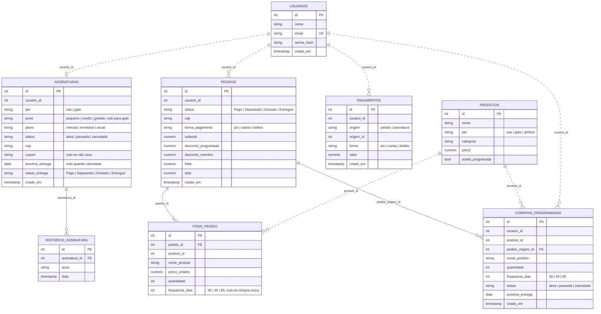

# Modelo de dados

Proposta de entidades e tabelas do back-end (tarefa T01 do [backlog](backlog.md)). Se o grupo quiser mudar algo, muda aqui por PR antes de criar a tabela.

## Diagrama

Linha contínua: chave estrangeira, dentro do mesmo módulo. Linha tracejada: referência só pelo id, entre módulos diferentes (sem chave estrangeira no banco).

## Tabelas por módulo

| Módulo | Tabelas | História |
|---|---|---|
| `contas` | `usuarios` | HU01 |
| `catalogo` | `produtos` | T03 (já criada) |
| `assinaturas` | `assinaturas`, `historico_assinatura` | HU06, HU11 |
| `pedidos` | `pedidos`, `itens_pedido`, `compras_programadas` | HU13, HU16 |
| `pagamentos` | `pagamentos` | HU19 |

Os planos do Clube e o cupom `PRIMEIRA10` não têm tabela: são constantes no `domain/` de `assinaturas`.

## Decisões

1. **Ids:** inteiros gerados pelo banco.
2. **Entre módulos, só o id.** Ex.: `pedidos.usuario_id` não tem chave estrangeira para `usuarios`. Assim cada módulo cria as tabelas dele sem depender da migration do outro.
3. **Item de pedido e compra programada guardam nome e preço do produto** no momento da compra. Se o preço mudar no catálogo depois, o pedido antigo continua com o valor que o cliente pagou.
4. **Dinheiro:** `Numeric(10, 2)` no banco e `Decimal` no Python. O arredondamento fica em `ciclobox/shared/dinheiro.py` (função `arredondar`), para todos os módulos usarem a mesma.
5. **Campos com valores fixos** (pet, status, plano...) são texto com `CheckConstraint`, não enum nativo do Postgres. Enum nativo complica a migration quando um valor muda.
6. **`criado_em`** é preenchido pelo banco (`server_default=func.now()`).
7. **Carrinho no front.** Não tem tabela de carrinho: a API recebe os itens no cálculo e no checkout.
8. **Status de entrega da caixa do Clube** fica na própria `assinaturas` (`status_entrega`), separado dos pedidos da loja. Assim `pedidos` depende de `assinaturas` (para saber se o cliente é membro), mas `assinaturas` não depende de `pedidos`.
9. **Login (proposta, decidir na HU02):** token JWT com a lib `PyJWT` e hash de senha com `pwdlib[argon2]`, que são as que a documentação do FastAPI usa hoje.

## Como uma tabela nova entra no projeto

Seguindo o exemplo do `catalogo` (T03):

1. Entidade no `domain/` (`dataclass`, sem SQLAlchemy). Ex.: [`catalogo/domain/produto.py`](../backend/src/ciclobox/catalogo/domain/produto.py).
2. Interface do repositório no `ports.py`. Ex.: [`catalogo/ports.py`](../backend/src/ciclobox/catalogo/ports.py).
3. Model do SQLAlchemy em `adapters/models.py` e repositório em `adapters/`. Ex.: [`catalogo/adapters/`](../backend/src/ciclobox/catalogo/adapters/).
4. Importar o `models.py` novo em [`migrations/env.py`](../backend/migrations/env.py), senão o Alembic não enxerga a tabela.
5. Gerar a migration dentro de `backend/`: `uv run alembic revision --autogenerate -m "cria tabela xyz"`, conferir o arquivo gerado e rodar `uv run alembic upgrade head`.
